<p align="center">
  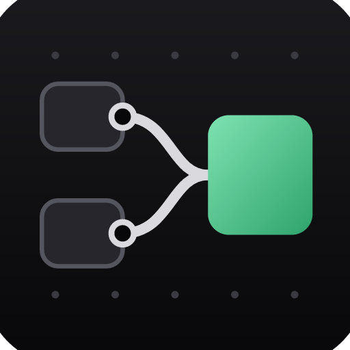
</p>

<h1 align="center">NodeCraft</h1>

<p align="center">
  <b>A native, node-based canvas for generative media, written in pure Rust.</b><br>
  Wire text, image, video, audio, 3D and documents into any AI model and deterministic tools,<br>
  branch ideas visually, and package workflows as reusable Techniques.
</p>

<p align="center">
  
  
  
  
</p>

<p align="center">
  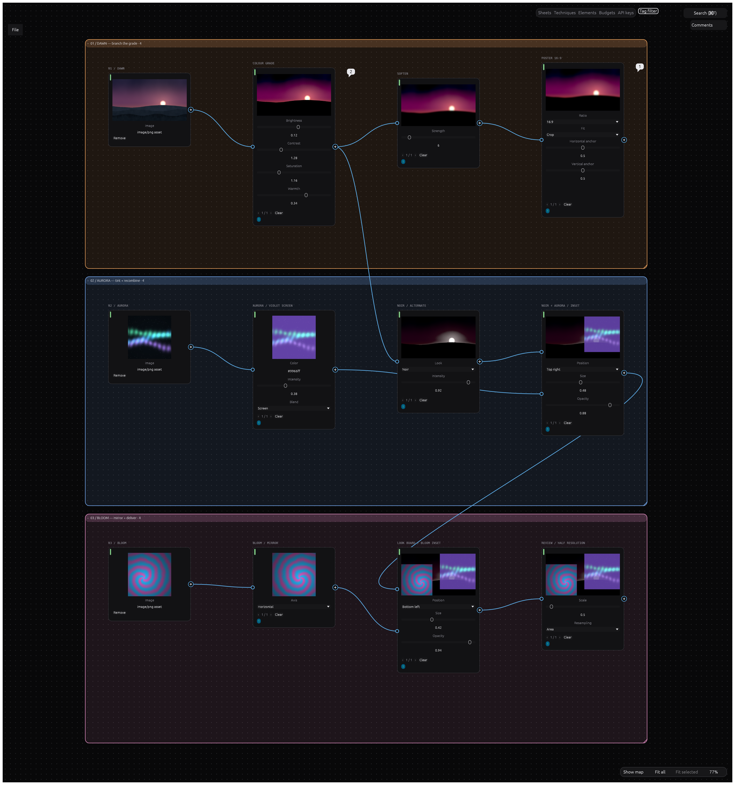
</p>

---

> [!NOTE]
> NodeCraft is being built in the open, three days in. The canvas, the document model, undo,
> automation surfaces and the whole generation engine are in the tree; the step in progress is
> wiring that engine to the app, so **the app does not generate yet**; it does save and open `.ncraft` projects.
> [`ROADMAP.md`](ROADMAP.md) says exactly what works, what does not, and what is next.

## What it does today

`cargo run -p nodecraft` opens a real editing canvas:

- **Edit**: pan/zoom dot-grid canvas, node cards generated from each node's parameter schema,
  noodles you can draw, rewire and delete, selection by click/Shift/marquee plus
  upstream/downstream/by-kind, a minimap with zoom-to-fit and zoom-to-selection, incremental search,
  a searchable quick-add palette with per-key shortcuts, "Turn into" when you drop a noodle on
  empty canvas, drag-to-reorder input order badges, copy/cut/paste/duplicate through the OS
  clipboard, OS file drop that creates source nodes, pinned discussions and Notes, grid/dependency
  formatting, and named colour tags with a bounded highlight filter.
- **Never lose work**: every edit is an invertible changeset, so undo/redo covers everything, and
  command dispatch runs under a panic guard. No `unsafe` and no `unwrap` outside tests.
- **Keep your keys yours**: an API keys panel over the OS keychain.
- **Drive it from outside**: an MCP server (`nodecraft-cli mcp`, and `--bridge` to drive the app
  you have open), a headless control channel (`nodecraft --control`, `nodecraft-cli control`), all
  dispatching the same 66 commands the UI uses. `nodecraft-cli inspect`, `quote` and `providers`
  read a project's canvases, price a run as the canvas would, and say which providers can run.

## The canvas, frame by frame

Every frame below is one rendered frame of the real app — `NodeCraftApp::show`, drawn offscreen by
the same `egui_kittest` wgpu path the snapshot tests use, committed by an opt-in tool
([`tools/eyecandy`](tools/eyecandy/README.md)). It is the same document seen from different
distances. The cards were placed by engine commands, the plate came in through the same import path
a file drop takes,
and the graded, softened and cropped thumbnails are local deterministic actions the app recomputed
for itself. What is *not* in them: a model call. Provider wiring is the milestone in progress.

### A card is generated from its node's parameter schema

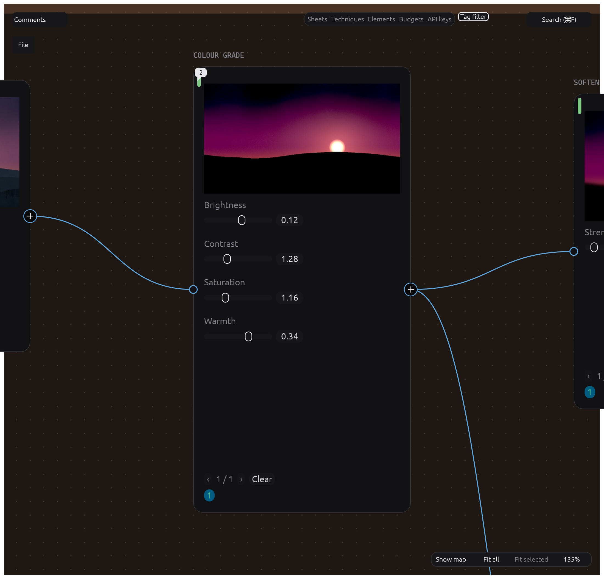

`image.grade` declares four numbers, so the shell draws four sliders. Nothing in the card body was
laid out by hand: node kinds declare ports and a schema, and the card, the inspector and the MCP
schema are all generated from that.

### Local actions recompute while you edit

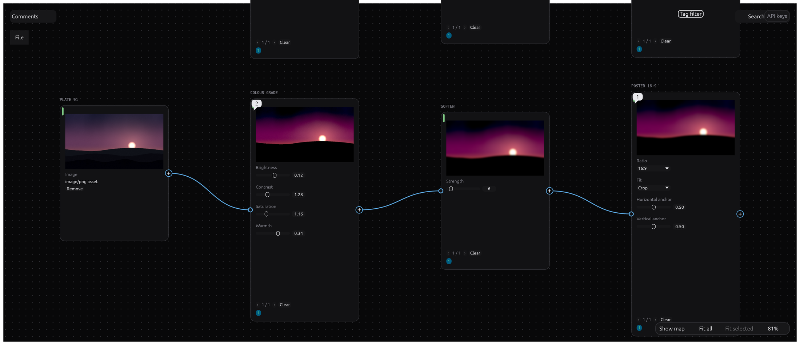

Grade, then soften, then crop to 16:9. Each card shows the result its upstream card produced, and
the pass that computed them runs on the app's own worker
([#88](../../issues/88)): move a slider and the next frame recomputes.

### Quick-add: double-click empty canvas, type, create

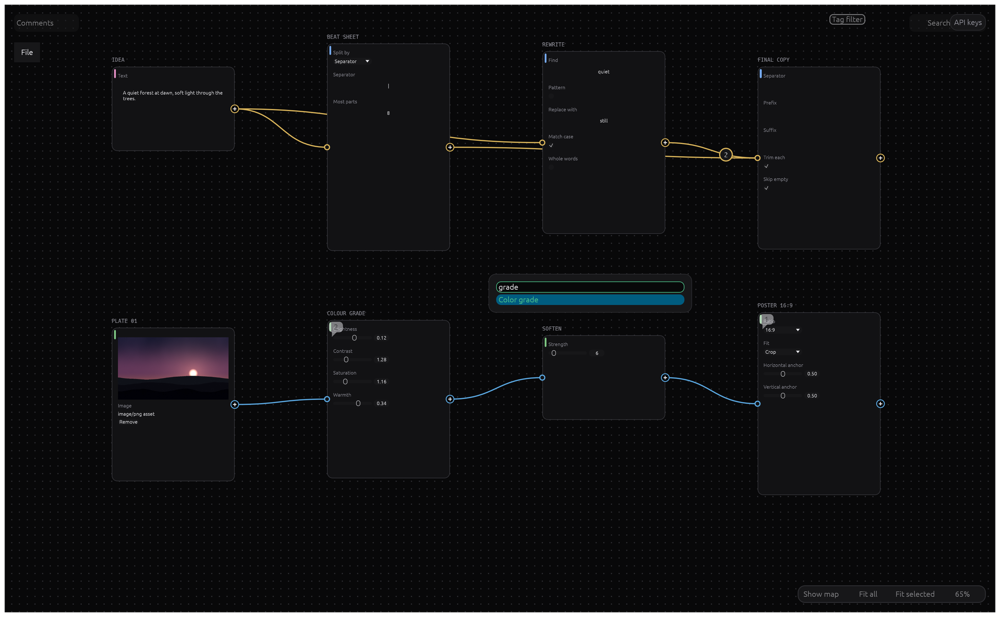

The palette is searchable, filters as you type, and puts creation one key away. Every entry is a
node kind, and the CLI and the MCP server create the same card with the same `node.create` command.

### Tags, and a filter that highlights what matches

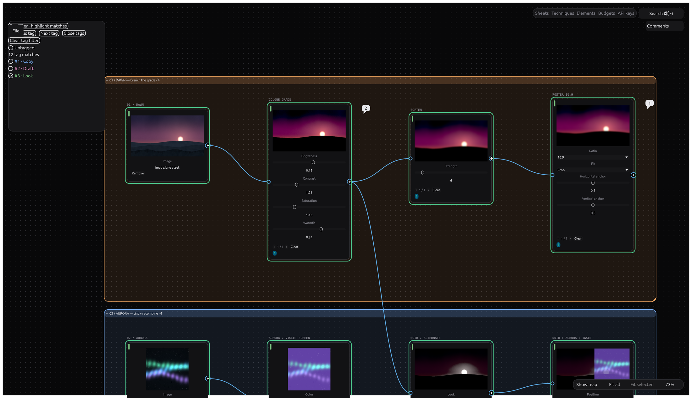

Named colour tags per canvas, a bounded highlight filter, and a small colour marker on every
tagged card.

### Discussions pinned to the card they are about

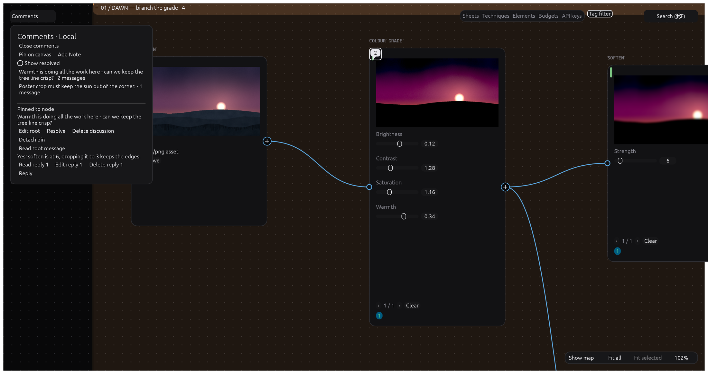

Comments live on the canvas, anchor to a card, move with it, and thread.

### Six modalities, six wire colours

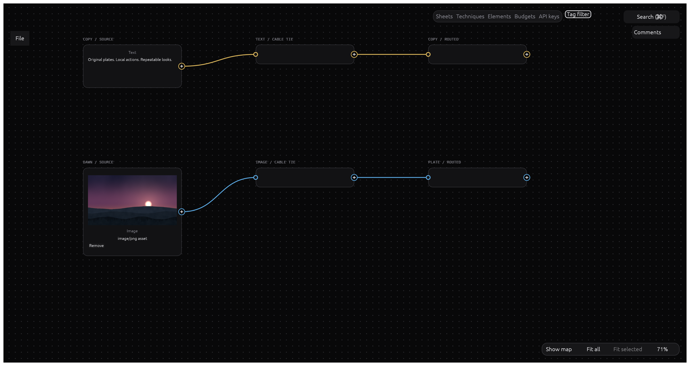

Text, image, video, audio, 3D and document each own a colour, so a noodle tells you what it carries
before you hover it. Here the video pair is purple and the audio pair orange; the 3D and document
routers carry green and grey ports and have nothing upstream to take yet — the app has no source
card for either. A router carries one modality per instance and adds no step and no cost: the run
planner resolves it away.

### One set of theme tokens, both palettes

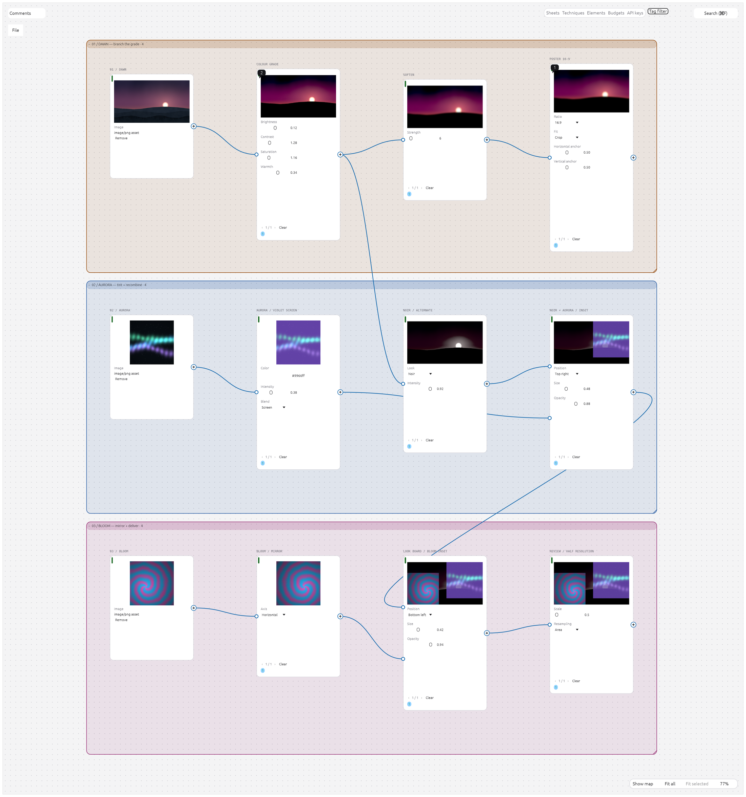

Dark and light come from one token table in `crates/ui-egui/src/theme.rs`: widgets ask for a
role — `panel_fill`, `wire_image` — never a colour.

<details>
<summary>Three more frames of the same document</summary>

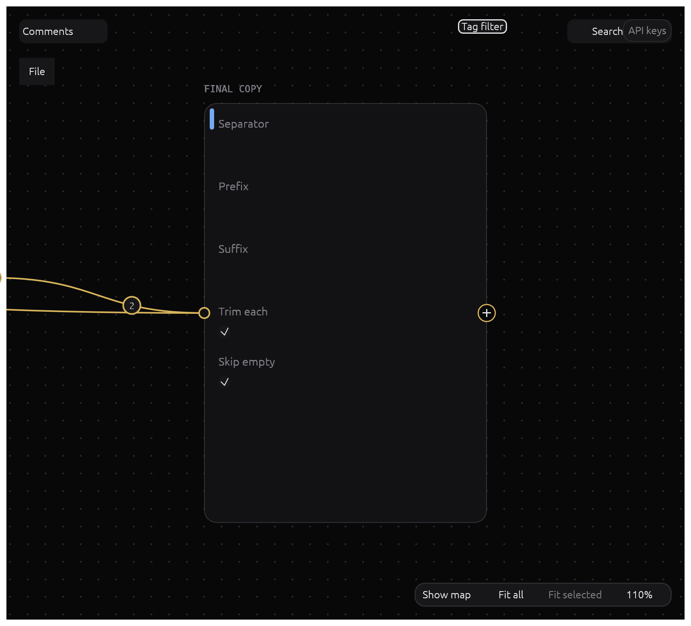

Order on a list input is data, not layout: drag a badge and the order in the document changes.

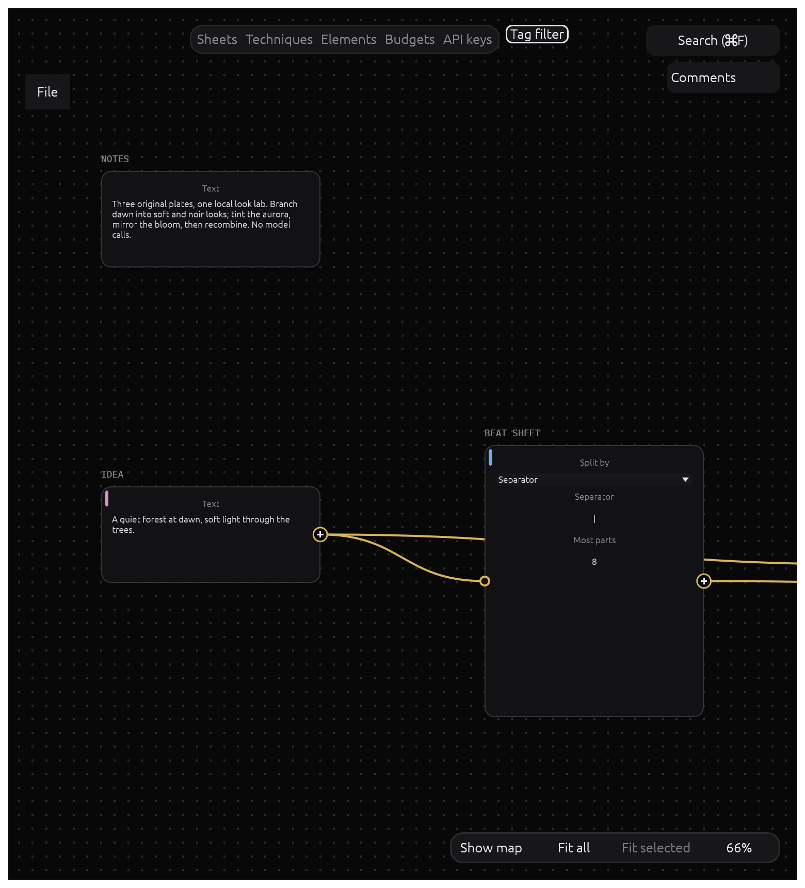

Notes are cards too, so the brief travels with the work it describes.

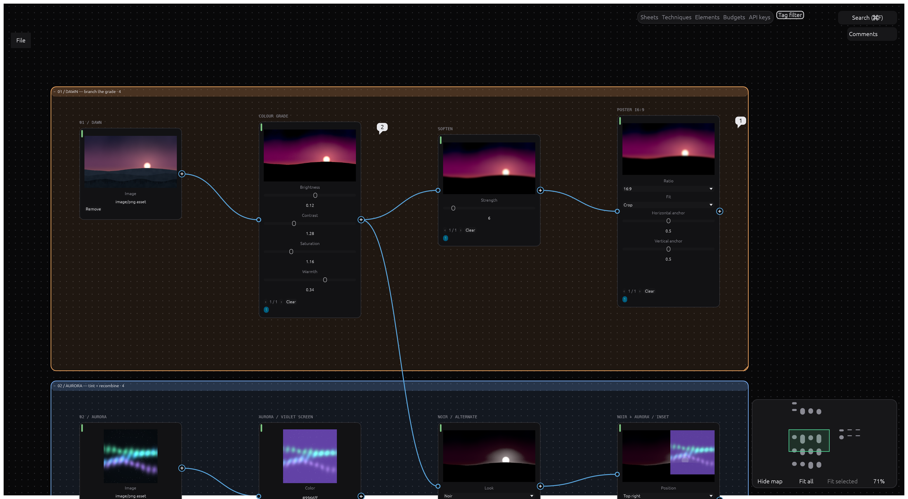

The shell around the canvas: a minimap with zoom-to-fit and zoom-to-selection, a zoom badge, and a
top bar of the same commands the shortcuts and the palette drive. Notices — what went wrong, or why
a key did nothing — are painted into the bottom-left corner, and only when there is something to
report, so an honest frame has none in it.

</details>

## What it will do

The engine behind generation is already built and tested — plan → quote → budget → schedule →
execute → record → history, with cost shown before a run and budgets held while jobs run. The work
now is connecting it to the window. The target:

- **Any model, one node per modality.** The model is a parameter: search compatible models, swap
  without rewiring, or run several side by side. Each run shows its cost before it starts.
- **ComfyUI first-class.** Import any workflow as a node with typed ports, follow live progress,
  and switch a node between cloud models and local ComfyUI without rewiring.
- **Providers**: LLM endpoints (OpenAI-compatible, Anthropic, LiteLLM, Ollama), OpenAI Images,
  Replicate, Seedream, Tripo and Meshy are written; fal.ai, Google Imagen/Gemini image/Veo/TTS,
  ElevenLabs, Seedance and Kling are tracked as issues.
- **Deterministic actions** — colour grading, blur, crop, aspect ratio, split into grid, text and
  video operations, PDF pages and text — recompute live, with custom actions authored as GPU shaders.
- **Editors inside nodes**: a Layer Editor, a Timeline, Mask/Inpaint, and a 3D viewer that captures
  photos, turntables and multi-view sheets.
- **Reuse**: Batch and Router nodes, Elements, and a Technique Builder that turns a workflow into
  one node, an app-mode form, a CLI command and an MCP tool.
- **Agent-ready**: an in-canvas agent builds and runs workflows with the same commands as the UI.
- **Yours**: local `.ncraft` projects with content-addressed assets, working offline with your own
  keys.

## Under the hood

- A Rust 2024 workspace of 17 layered crates and 3 apps (`types` → `graph` →
  `nodes`/`catalog`/`actions` → `exec`/`providers`/`gpu`/`format` → `engine` →
  `ui-egui`/`agent`/`automation`), with the layering enforced by `cargo xtask layers`.
- egui/eframe on wgpu. Every library crate also builds for `wasm32-unknown-unknown`, checked by
  `cargo xtask wasm`; `apps/nodecraft-web` runs the same app in a browser (a preview).
- Every action is a command with typed JSON params, and every edit is an invertible changeset —
  undo, autosave, automation and future live collaboration all use that one path.
- Built never to crash: no `unsafe`, no `unwrap`/`panic` outside tests, hostile input bounded at
  every boundary, and `panic_hunt` fuzzing each command with adversarial parameters.
- 1,200+ tests and rising, including property tests for changesets and the planner, golden
  graphs against a mock provider, fixture contract tests for providers, and `egui_kittest` tests
  that push real pointer and key events through the canvas.
- Shares UI, settings, atomic-save, quit and PDF libraries with the other Craft apps through
  [craft-libs](https://github.com/storytold/craft-libs).
- A dated decision record per choice in [`docs/decisions/`](docs/decisions/) explains the
  trade-offs a later contributor might otherwise undo (`cargo xtask decisions` prints the count).

See [`docs/plan.md`](docs/plan.md) for the feature catalogue, architecture and roadmap, and
[`docs/architecture.md`](docs/architecture.md) for the crate map.

## Build from source

```sh
cargo run -p nodecraft          # the desktop app
cargo xtask ci                  # fmt, clippy, tests, layers, decisions, wasm
```

[`docs/development.md`](docs/development.md) has the details; [`AGENTS.md`](AGENTS.md) is the
orientation for contributors and coding agents.

## Downloads

Two pre-releases exist. [`v0.2.0-rc.1`](../../releases/tag/v0.2.0-rc.1) is the current build:
installers for macOS, Windows and Linux of that pre-release snapshot. Build `main` for the latest
canvas features; generation and saving from the app are still being wired. [`v0.1.0-rc.1`](../../releases/tag/v0.1.0-rc.1) is the
M0-era build that proved the release pipeline. Signed installers arrive with the first real
release ([#100](../../issues/100)); macOS and Windows builds are unsigned for now, so the first
launch shows a warning — [`docs/install.md`](docs/install.md) shows how to open them anyway.
Release builds ship `nodecraft-cli` with the integrated MCP server, bundled in the Linux and
Windows packages and also as a separate macOS download.

## Contributing

Pick an issue and comment `/claim`. A bot assigns it to you, and you open a draft PR within
24 hours. [`CONTRIBUTING.md`](CONTRIBUTING.md) has the claim rules, the non-negotiable code rules
and checklists for adding commands, node kinds and providers.

## Status and roadmap

| Milestone | Focus | Where it stands |
|---|---|---|
| M0 | Workspace skeleton, lints, CI, empty canvas | done |
| M1–M2 | Canvas core, organisation tools | canvas nearly done; fields UI to wire |
| M3 | Generation engine, providers, history, cost | engine built and tested, app not wired yet |
| M4–M5 | Actions, Batch, Techniques, CLI | actions built as a library; M5 not started |
| M6–M8 | Layer/Timeline/Mask editors, video, audio, 3D, PDF | not started |
| M9–M10 | Agent, MCP, browser build, collaboration | MCP and control channel work; no agent yet |

Full detail, including what does not work yet: [`ROADMAP.md`](ROADMAP.md).

## License

Dual-licensed under [MIT](LICENSE-MIT) or [Apache-2.0](LICENSE-APACHE), at your option.
