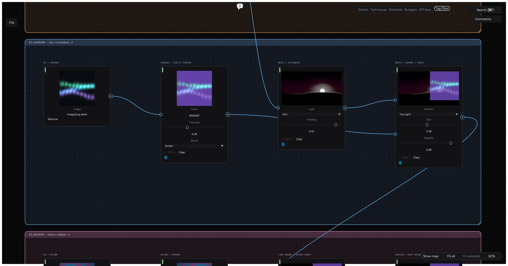
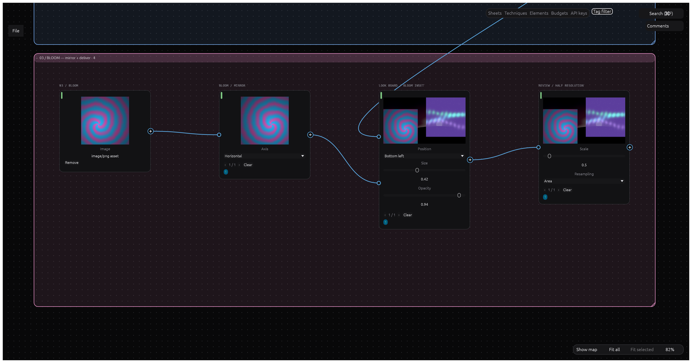

<p align="center">
  
</p>

<h1 align="center">NodeCraft</h1>

<p align="center">
  <b>A native, node-based canvas for generative media, written in pure Rust.</b><br>
  Wire text, image, video, audio, 3D and documents into any AI model and deterministic tools,<br>
  branch ideas visually, and package workflows as reusable Techniques.
</p>

<p align="center">
  
  
  
  
</p>

<p align="center">
  
</p>

---

> [!NOTE]
> NodeCraft is being built in the open. The M1 canvas core, the M2 organisation tools
> (fields, tags, comments, search, auto-format, bulk editing, routers) and the M4 local actions
> (image and text actions that recompute as you edit, result reuse, custom shaders, text-action
> plugins) are complete. The desktop saves and opens `.ncraft` projects and can run supported
> generation cards through its wired host. That does **not** mean every catalog model or provider works on every
> platform. See
> [`ROADMAP.md`](ROADMAP.md) for current limitations and next steps.

## Build a creative pipeline, not a pile of prompts

Start with a brief and reference images. Branch into different looks, compare the results, then
carry the chosen direction into a composite, a video edit or a reusable workflow. The canvas keeps
the inputs, settings and connections beside the work instead of hiding them in a chat history.

## What it does today

`cargo run -p nodecraft` opens a real editing canvas:

- **Edit**: pan/zoom dot-grid canvas, node cards generated from each node's parameter schema,
  noodles you can draw, rewire and delete, selection by click/Shift/marquee plus
  upstream/downstream/by-kind, a minimap with zoom-to-fit and zoom-to-selection, incremental search,
  a searchable quick-add palette with per-key shortcuts, "Turn into" when you drop a noodle on
  empty canvas, drag-to-reorder input order badges, copy/cut/paste/duplicate through the OS
  clipboard, OS file drop that creates source nodes, pinned discussions and Notes, grid/dependency
  formatting, router nodes as cable ties, a bulk parameter panel, named colour tags with a
  bounded highlight filter and tag navigation, and fields: named, coloured zones that move with
  their members and collapse to a header that search, tag navigation, the minimap and Fit all
  respect. Save/open `.ncraft` projects and recover unsaved work on desktop; supported generation
  cards can run through the desktop host.
- **Act locally**: image actions (grade, blur, crop, aspect, key, overlay and more) and text
  actions (split, replace, template, concat) are cards that recompute on a worker as you edit,
  with smaller previews while a slider drags. A card whose identical result is already in the
  project reuses it instead of computing or paying again; model cards opt in per card with
  `node.cache_set`. Custom shader cards run WGSL with declared sliders on the GPU, and a text
  model can write or fix one through an ordinary priced card. The Plugins panel checks, installs
  and grants `.ncraft-plugin` packages; a granted text-action package adds its actions as cards.
- **Compose and finish**: a Layer Editor combines wired images, text and shapes; Mask/Inpaint
  paints masks and prepares inpaint/outpaint cards. Image tools add wired action cards in one
  undo step. Elements keep named image references reusable across projects. A Timeline arranges
  picture, sound and captions; desktop video playback and rendering need your own FFmpeg.
- **Present and share**: turn a selection into a Deck, edit its slides and export PDF or PNG.
  Live sessions carry edits, images, discussions, pointers and selections between desktop and
  browser clients through a relay; internet deployment needs the transport setup described in
  [`ROADMAP.md`](ROADMAP.md#what-does-not-work-yet).
- **Never lose work**: every edit is an invertible changeset, so undo/redo covers everything, and
  command dispatch runs under a panic guard. No `unsafe` and no `unwrap` outside tests.
- **Keep your keys yours**: an API keys panel over the OS keychain.
- **Drive it from outside**: an MCP server (`nodecraft-cli mcp`, and `--bridge` to drive the app
  you have open), a headless control channel (`nodecraft --control`, `nodecraft-cli control`), all
  dispatching the same stable dotted commands the UI uses. `nodecraft-cli inspect`, `quote` and `providers`
  read a project's canvases, price a run as the canvas would, and say which providers can run;
  `nodecraft-cli run` runs it (a paid run needs `--yes`) and exports the results to a folder.

## What does not work yet

- A model in the catalog is not proof that its adapter, mode and credentials are usable in every
  host. Browser provider options and some local endpoints differ from desktop; see
  [`docs/providers.md`](docs/providers.md) and [`ROADMAP.md`](ROADMAP.md).
- The text card's chat-style turn UI (#84) and first signed release (#100) are still open.
  `nodecraft-cli serve` exists on current `main` even though its tracking issue #117 remains open;
  see [`docs/serve.md`](docs/serve.md). The published release candidates predate current `main`.
- Presented-frame P1–P3 passed on one 120 Hz Apple M3 Pro/Metal setup (#65, #634), not a 60 Hz
  display or Windows/Linux hardware; the older headless CPU timings are commit-bound historical
  results, not current universal frame guarantees. See [`docs/performance.md`](docs/performance.md).

## The canvas, frame by frame

Every image below is a frame of the real app — `NodeCraftApp::show`, drawn offscreen through
`egui_kittest` and wgpu by the opt-in [`gallery renderer`](tools/eyecandy/README.md). The same
showcase document contains three original procedural plates, parallel image treatments, two
composites, a text branch, notes and typed routers. Coloured fields organise the image pipeline.

The cards and wires were created through engine commands. The plates use the file-drop import
path; the previews are actual local-action results, not pasted-in answers. **No model was called
for these captures**, and they do not demonstrate live provider responses.

### Branch a look, then bring the branches back together



The dawn grade branches into a soft poster treatment and a noir alternative. Meanwhile, a second
plate gets a violet screen tint. The noir and tinted aurora meet at a two-input overlay: the
connections show exactly which look contributes to the result. Fields keep the stages named,
coloured and movable as a group.

### Build a review composite from several sources



Mirror the bloom, inset it into the previous composite, then resize for review. These are ordinary
wired action cards: change an upstream setting and the dependent local results recompute. Keep
alternate paths beside the final path instead of overwriting an earlier experiment.

### A card is generated from its node's parameter schema


`image.grade` declares four numbers, so the shell draws four sliders. Nothing in the card body was
laid out by hand: node kinds declare ports and a schema, and the card, the inspector and the MCP
schema are all generated from that.

### Local actions recompute while you edit


Grade, then soften, then keep the output at 16:9 (the original dawn plate already has that ratio).
Each action card shows its own computed result. The pass runs on the app's worker
([#88](../../issues/88)): move a slider and dependent results recompute asynchronously.

### Quick-add: double-click empty canvas, type, create


The palette is searchable, filters as you type, and puts creation one key away. Every entry is a
node kind, and the CLI and the MCP server create the same card with the same `node.create` command.

### Tags, and a filter that highlights what matches


Named colour tags per canvas, a bounded highlight filter, and a small colour marker on every
tagged card.

### Discussions pinned to the card they are about


Comments live on the canvas, anchor to a card, move with it, and thread.

### Typed wires, tidy routing


A wire tells you what it carries before you hover it. This frame shows text in gold and images in
blue; video, audio, 3D and documents have their own colours too. Routers keep long connections tidy,
carry one modality per instance and add no generation step or provider cost: the planner resolves
them away.

### One set of theme tokens, both palettes


Dark and light come from one token table in `crates/ui-egui/src/theme.rs`: widgets ask for a
role — `panel_fill`, `wire_image` — never a colour.

<details>
<summary>Three more frames of the same document</summary>


Order on a list input is data, not layout: drag a badge and the order in the document changes.


Notes are cards too, so the brief travels with the work it describes.


The shell around the canvas: a minimap with zoom-to-fit and zoom-to-selection, a zoom badge, and a
top bar of the same commands the shortcuts and the palette drive. Notices — what went wrong, or why
a key did nothing — are painted into the bottom-left corner, and only when there is something to
report, so an honest frame has none in it.

</details>

## Generation, media and reuse

The generation path is connected to the desktop for supported models: plan → quote → budget →
schedule → execute → record → history. Before a paid run, inspect its quote and budget. These
capabilities extend beyond the local-action gallery above; support still varies by model, mode
and host, and several milestone exit criteria remain open.

- **Any model, one node per modality.** The model is a parameter: search compatible models, swap
  without rewiring, or run several side by side. Each run shows its cost before it starts.
- **ComfyUI first-class.** Import any workflow as a node with typed ports, follow live progress,
  and switch a node between cloud models and local ComfyUI without rewiring.
- **Providers**: LLM endpoints (OpenAI-compatible, Anthropic, LiteLLM, Ollama), OpenAI Images,
  Replicate, Seedream, Tripo, Meshy, Higgsfield, Gemini images, Gemini Omni Flash video, and Veo
  3.1 and Google TTS on Google Cloud have adapters. ComfyUI now accepts video/audio workflows;
  fal.ai, ElevenLabs, Seedance (BytePlus ModelArk) and Kling's own task API also have adapters.
  Adapters and
  catalog entries are not proof of usable workflows in every host. Consult
  [`docs/providers.md`](docs/providers.md) for per-adapter modes, authentication and limitations;
  desktop and browser support differ.
- **Deterministic actions** — colour grading, blur, crop, aspect ratio, split into grid, text
  operations, PDF pages and text — recompute live, with custom actions authored as GPU shaders;
  video actions run when asked. Built-in image actions run on the CPU today; their tested wgpu
  path is not yet used by the app.
- **Editors inside nodes**: a Layer Editor, a Timeline, Mask/Inpaint, and a 3D viewer that captures
  photos, turntables and multi-view sheets.
- **Reuse**: Batch and Router nodes, Elements, Techniques and app mode have shipped in part; the
  milestone still has open issues before promising identical results on every surface.
- **Agent-ready**: an in-canvas agent builds and runs workflows with the same commands as the UI.
- **Yours**: local `.ncraft` projects with content-addressed assets, working offline with your own
  keys.

## Under the hood

- A Rust 2024 workspace of layered crates and desktop, CLI and browser apps (`types` →
  `graph` → `nodes`/`catalog`/`actions` → `exec`/`providers`/`gpu`/`format` →
  `engine` → `ui-egui`/`agent`/`automation`), enforced by `cargo xtask layers`.
- egui/eframe on wgpu. Every library crate also builds for `wasm32-unknown-unknown`, checked by
  `cargo xtask wasm`; `apps/nodecraft-web` runs the same app in a browser (a preview).
- Every action is a command with typed JSON params, and every edit is an invertible changeset —
  undo, autosave, automation and future live collaboration all use that one path.
- Built never to crash: no `unsafe`, no `unwrap`/`panic` outside tests, hostile input bounded at
  every boundary, and `panic_hunt` fuzzing each command with adversarial parameters.
- 1,200+ tests and rising, including property tests for changesets and the planner, golden
  graphs against a mock provider, fixture contract tests for providers, and `egui_kittest` tests
  that push real pointer and key events through the canvas.
- Shares UI, settings, atomic-save, quit and PDF libraries with the other Craft apps through
  [craft-libs](https://github.com/storytold/craft-libs).
- A dated decision record per choice in [`docs/decisions/`](docs/decisions/) explains the
  trade-offs a later contributor might otherwise undo (`cargo xtask decisions` prints the count).

See [`docs/plan.md`](docs/plan.md) for the feature catalogue, architecture and roadmap, and
[`docs/architecture.md`](docs/architecture.md) for the crate map.

## Build from source

```sh
cargo run -p nodecraft          # the desktop app
cargo xtask ci                  # fmt, clippy, tests, layers, decisions, wasm
cargo xtask ci --quick          # the same for changed packages only, without slow tests or wasm
```

[`docs/development.md`](docs/development.md) has the details; [`AGENTS.md`](AGENTS.md) is the
orientation for contributors and coding agents.

## Downloads

Two pre-releases exist. [`v0.2.0-rc.1`](../../releases/tag/v0.2.0-rc.1) is the current build:
installers for macOS, Windows and Linux of that pre-release snapshot. Build `main` for the latest
canvas features: this pre-release predates much of the current desktop storage and generation wiring. [`v0.1.0-rc.1`](../../releases/tag/v0.1.0-rc.1) is the
M0-era build that proved the release pipeline. Signed installers arrive with the first real
release ([#100](../../issues/100)); macOS and Windows builds are unsigned for now, so the first
launch shows a warning — [`docs/install.md`](docs/install.md) shows how to open them anyway.
Release builds ship `nodecraft-cli` with the integrated MCP server, bundled in the Linux and
Windows packages and also as a separate macOS download.

## Contributing

Pick an issue and comment `/claim`. A bot assigns it to you, and you open a draft PR within
24 hours. [`CONTRIBUTING.md`](CONTRIBUTING.md) has the claim rules, the non-negotiable code rules
and checklists for adding commands, node kinds and providers.

## Status and roadmap

| Milestone | Focus | Where it stands |
|---|---|---|
| M0 | Workspace skeleton, lints, CI, empty canvas | done |
| M1–M2 | Canvas core, organisation tools | done |
| M3 | Generation engine, providers, history, cost | desktop host wired; remaining modes and issues open |
| M4 | Actions, live recompute, custom shaders | done: local actions, result reuse, shader cards and text-action plugins work |
| M5 | Batch, Techniques, CLI, first release | partial; reuse surfaces shipped in part, first signed release open |
| M6–M8 | Layer/Timeline/Mask editors, video, audio, 3D, PDF | partial, with working desktop surfaces and open gaps |
| M9–M10 | Agent, MCP, browser build, collaboration | agent, control and sync work on desktop; other surfaces partial |

Full detail, including what does not work yet: [`ROADMAP.md`](ROADMAP.md).

## License

Dual-licensed under [MIT](LICENSE-MIT) or [Apache-2.0](LICENSE-APACHE), at your option.
